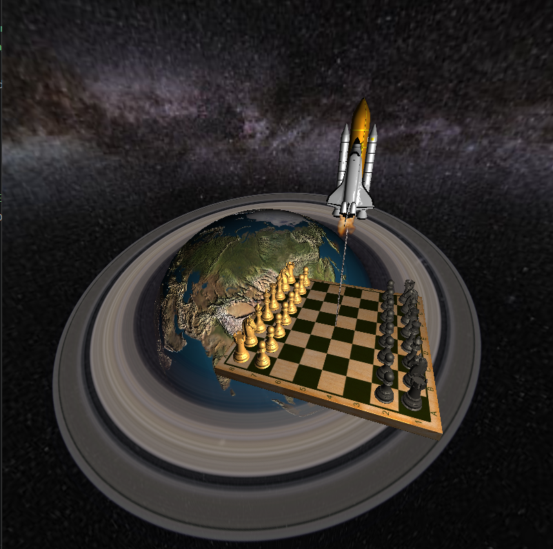

# OpenGL 3D Chess Scene

A real-time 3D scene written in C++ and OpenGL 3.3: a chessboard with animated pieces, a space shuttle, a textured Earth under a star sky, and an animated fire. Final project for **3D Computer Graphics**, La Salle – Universitat Ramon Llull (2024/25).

<!-- Add 2-3 screenshots here, e.g.:


-->

## Features
- **First-person camera:** mouse movement updates yaw and pitch (pitch clamped to ±89°), which are converted into a view direction; WASD moves the camera. The view matrix comes from `glm::lookAt`, with a perspective projection.
- **Transforms:** every object is placed with its own model matrix (translate · rotate · scale). Normals use the normal matrix `transpose(inverse(model))`, so lighting stays correct under non-uniform scaling.
- **Lighting:** Blinn-Phong shading (ambient, diffuse and specular with a half-vector) in GLSL. The Earth adds a **normal map** (tangent frame built from screen-space derivatives) and a **specular map**.
- **Sky:** a textured sphere drawn first, without depth testing, and moved with the camera so it always surrounds the viewer.
- **Chess animation:** a timed, multi-phase sequence; pieces move at a fixed speed scaled by frame time, and the king finally tips over.
- **Animated fire (the course's "advanced topic", dynamic textures):** a 72-frame sprite sheet (6 × 12) on a plane; the vertex shader shifts the UV coordinates to the current frame.

## Controls
| Key | Action |
|---|---|
| Mouse | Look around |
| W / A / S / D | Move forward / left / back / right |
| P | Play the chess animation |
| N | Reset the pieces |
| R | Reload the scene |
| Esc | Quit |

## Build and run

### Windows (Visual Studio)
1. Install Visual Studio with the **Desktop development with C++** workload. The project uses the VS 2022 toolset (`v143`); on a newer Visual Studio, either add the *MSVC v143 build tools* component or let Visual Studio retarget the project.
2. Download the models and textures (see **Assets** below) into `Graphics_1/assets/` and `Graphics_1/textures/`.
3. Open `Graphics_1/visual_studio/Graphics_1.sln`, select **x64**, and run. The executable is written to `Graphics_1/`, and the working directory is set to that folder, so the shaders, models and textures are found by their relative paths.

GLEW, GLFW and GLM headers and the Windows libraries are included in `Graphics_1/include/` and `Graphics_1/libwin64/`; `glew32.dll` and `glfw3.dll` sit next to the executable.

### macOS
`Graphics_1/makefile` builds with clang against GLFW and GLEW (for example from Homebrew): run `make` inside `Graphics_1/`.

## Assets
The 3D models and most textures were downloaded and are **not included** in this repository. Sources:

| Asset | Source |
|---|---|
| Chessboard | https://www.vecteezy.com/vector-art/7553432-chess-board-with-wooden-texture-design |
| Pawn | https://free3d.com/3d-model/woodenchesspawnsidea-v1--434515.html |
| Rook | https://free3d.com/3d-model/woodenchessrooksideb-v2--120548.html |
| Knight | https://free3d.com/3d-model/woodenchessknightsidea-v1--382631.html |
| King | https://free3d.com/3d-model/woodenchesskingsidea-v1--60100.html |
| Queen | https://free3d.com/3d-model/woodenchessqueensidea-v1--894583.html |
| Bishop | https://free3d.com/3d-model/woodenchessbishopsidea-v1--617271.html |
| Rope | https://www.cgtrader.com/items/3095403/download-page |
| Shuttle | https://sketchfab.com/3d-models/space-shuttle-with-boosters-28c98646369f48ee84bc20c267bc685f |
| Animated fire texture | https://opengameart.org/content/animated-flame-texture |

The remaining objects and textures (Earth, sky, rings) came from the course's resources.

## Project structure
```
Graphics_1/
  src/            main.cpp (scene, camera, animation), GLSL shaders, helpers
  include/        GLM, GLEW, GLFW, stb_image headers
  libwin64/       GLEW and GLFW libraries for Windows
  assets/         .obj models (only plane.obj and sphere.obj are included)
  textures/       textures (not included)
  visual_studio/  Visual Studio solution and project
  makefile        macOS build
```
`src/fire.vert` and `src/fire.frag` are an earlier camera-facing billboard approach to the fire. They are not used in the final build, which uses the sprite-sheet shader (`shader_sky.vert` / `shader_sky.frag`).

## Credits
- Authors: Teodor Arsovski, Mateja Dzunic.
- <!-- TODO (Teodor): confirm, then keep or remove this line --> `Shader.cpp/.h` and `glfunctions.cpp/.h` are based on the course's starter code.
- Libraries: [GLM](https://github.com/g-truc/glm), [GLEW](https://glew.sourceforge.net/), [GLFW](https://www.glfw.org/), [stb_image](https://github.com/nothings/stb), [tiny_obj_loader](https://github.com/tinyobjloader/tinyobjloader).
